# agentviz-constellation

Your Claude Code sessions and their subagents as a star map, drawn with
[Strata](https://github.com/Preponderous-Software/strata). Every repo the
sessions work in is a faint nebula. Every session is a star, coloured by its
state. Its subagents are planets on visible orbit rings: they orbit fast while
working and drift slowly while resting, and they grow with their tool calls.
What a star is doing right now is drawn on it. A session that needs you pulses
with cyan beacon rings, and a glyph above it says why: a "?" for a question, a
padlock for a permission prompt.

One of the [agentviz](https://github.com/dmccoystephenson/agentviz) family:
ten views of the same feed.

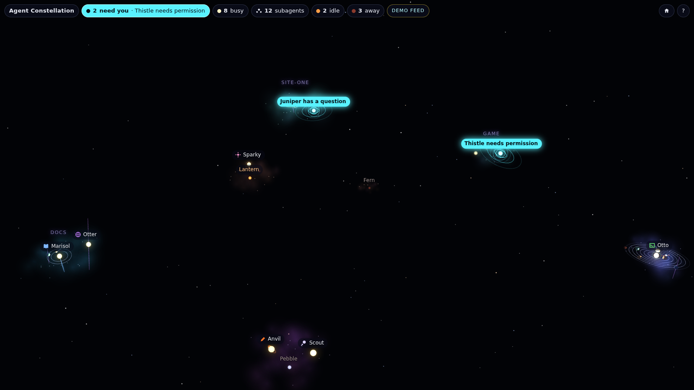
*The whole map (demo feed). Otto (right) is a lead with seven subagent
planets; Wren, the other lead, shares `site-one` with Juniper (top, its label
gives way to Juniper's). Juniper and Thistle need the owner: cyan labels that
say why, and the top chip, which names the next one and cycles through them.
Marisol and Otter read and surf in `docs`; Anvil, Scout and Pebble share
`engine`; Lantern and Sparky sit in the home nebula; Fern, alone in
`old-site`, is an offline ember.*

## Run

Needs Python 3.8 or newer and nothing else:

```bash
git clone https://github.com/dmccoystephenson/agentviz-constellation
cd agentviz-constellation
python3 -m vendor.agentfeed serve --web web --port 8847            # your live sessions
python3 -m vendor.agentfeed serve --web web --port 8847 --fixture  # the demo feed
```

Open <http://127.0.0.1:8847/> (the server binds 127.0.0.1 only and refuses
non-local `Host` headers). Live mode reads your Claude Code session files
under `~/.claude` and shows session names, states, git branches, tool names
and short labels (a file's basename, a Bash command's own description, a web
host, a subagent's description), never file contents, commands or prompts;
see the agentviz [SECURITY.md](https://github.com/dmccoystephenson/agentviz/blob/main/SECURITY.md).
Query options: `?fixture=1` (demo feed on a live server), `?fps=1` (frame
stats), `?quality=0|1|2`.

Drag to orbit, right-drag or two fingers to pan, wheel or pinch to zoom. Tap
a star or a planet: the camera flies to it and its card opens (a bottom sheet
on a phone, with the map shrunk to the space above it; swipe it down or tap
the cross to close). The cyan **need you** chip names who is waiting and why,
flies to them and cycles through them; the house button frames the whole map;
**?** opens the legend. If the feed stops answering, a banner says so and the
last snapshot stays; with no sessions at all, a hint says how to start.

## What you are looking at

| You see | It means | Close-up |
|---|---|---|
| A faint coloured cloud with an uppercase label | a **place**: the repo (working directory) the sessions are in; the more tool calls seen there, the thicker the cloud and the more bright knots | [hero](docs/media/hero.png) |
| A star | a **session** | [lead](docs/media/closeup-lead.png) |
| A planet on an orbit ring round a star | a **subagent** of that session | [lead](docs/media/closeup-lead.png) |
| Planet speed | fast = active (wrote < 2 min ago); slow and darker = resting | [delegate](docs/media/closeup-delegate-resting.png) |
| Planet size | grows with the subagent's tool calls | [lead](docs/media/closeup-lead.png) |
| A thin ring round a planet | the subagent says it has **finished** | [delegate](docs/media/closeup-delegate-resting.png) |
| A ring bursting off a star, or a planet flashing and swelling | a **new tool call** just now | [motion](docs/media/motion.gif) |

**States (the star's colour)**

| State | Star | Close-up |
|---|---|---|
| busy | bright yellow-white with a warm halo | [lead](docs/media/closeup-lead.png) |
| idle | dim orange | [idle-offline](docs/media/closeup-idle-offline.png) |
| waiting (needs you) | cyan-white star that **pulses**, cyan **beacon rings expanding outward** across its system, a light column, and above it a **"?"** (it asked a question) or a **padlock** (a permission prompt) that shows through everything; its label and the top chip say "has a question" / "needs permission" | [waiting](docs/media/closeup-waiting.png), [question](docs/media/closeup-question.png) |
| offline | small, faded red ember | [idle-offline](docs/media/closeup-idle-offline.png) |
| dim (shell or unknown) | small grey-blue | [engine](docs/media/closeup-engine.png) |
| stalled (busy, silent > 5 min) | the star **flickers** like a failing bulb and its label gets a warning sign; a stalled subagent's planet flickers too, with a red haze, and is always labelled | [stalled](docs/media/closeup-stalled.png), [lead](docs/media/closeup-lead.png) |

**Actions (drawn on the star, and in miniature on planets)**

| Action | Effect | Colour | Close-up |
|---|---|---|---|
| edit | **flares** that leap off the surface and fall back | orange | [engine](docs/media/closeup-engine.png) |
| run | a **pulsing corona** ring | green | [lead](docs/media/closeup-lead.png) |
| read | a slow **beam sweeping** round, like a lighthouse | blue | [read-web](docs/media/closeup-read-web.png) |
| web | **jets** streaming out of both poles to the edge of the system | violet | [read-web](docs/media/closeup-read-web.png) |
| delegate | its **orbits glow** pulsing gold | gold | [delegate](docs/media/closeup-delegate-resting.png) |
| think | a **steady**, slowly breathing glow | lavender | [engine](docs/media/closeup-engine.png) |
| other (MCP, Skill, ...) | a **shimmer** of sparkles | pink | [idle-offline](docs/media/closeup-idle-offline.png) |

## Screenshots

All from the fixture feed (`--fixture` / `?fixture=1`), never live sessions.

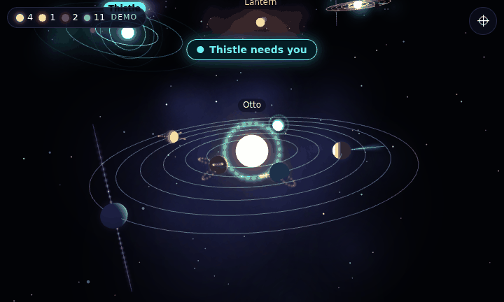
*Five seconds of Otto's system: planets orbiting (the resting "cache
warm-up" barely moves), flares, the pulsing green corona, the sweeping beam,
the jet, and a white ring bursting off the star or a planet flashing at each
new tool call.*


*A lead and its subagents: Otto is running a command (green pulsing corona);
its seven planets edit (orange flares), read (blue beam), run and surf the web
(violet jet), each on its own ring. "cache warm-up" is stalled: a reddish,
flickering planet, labelled with a warning sign even when Otto is not
selected.*

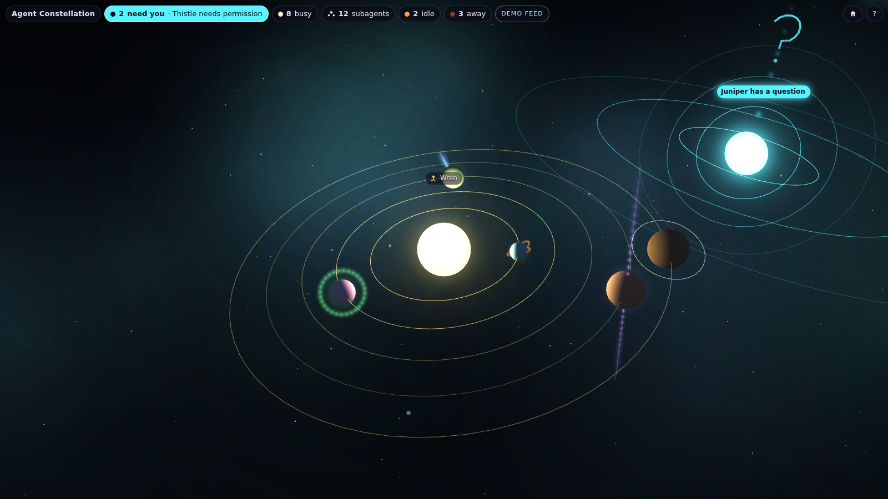
*Wren is delegating, so its orbits glow gold; its outermost planet ("tests +
docs") is resting and finished: darker, no haze, barely moving, with a thin
ring round it. Juniper, waiting with a question, is its neighbour in
`site-one`.*

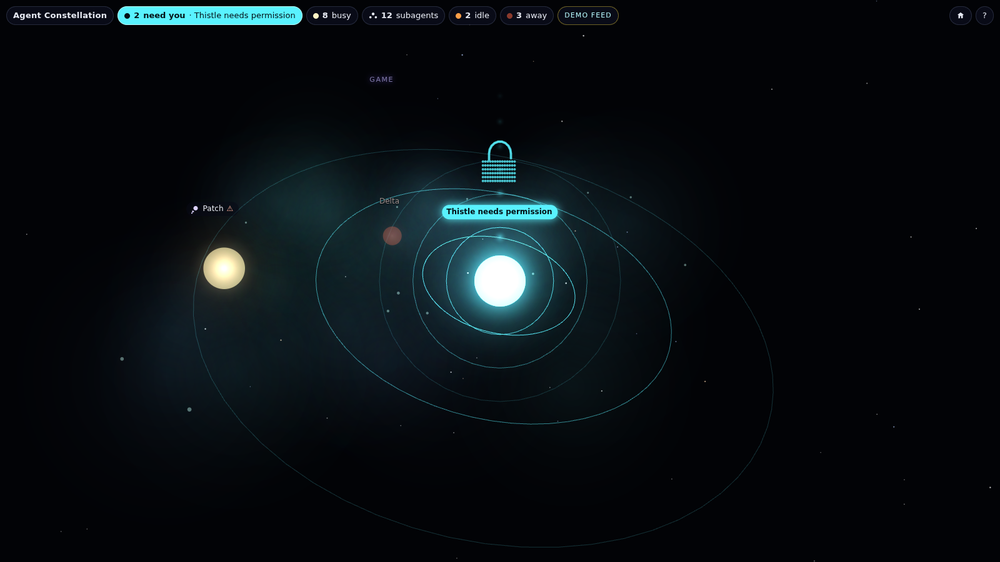
*Waiting on a permission prompt: Thistle pulses cyan, beacon rings sweep
outward across its system, and a padlock floats above it. Patch (left) and
the offline ember Delta share `game`.*

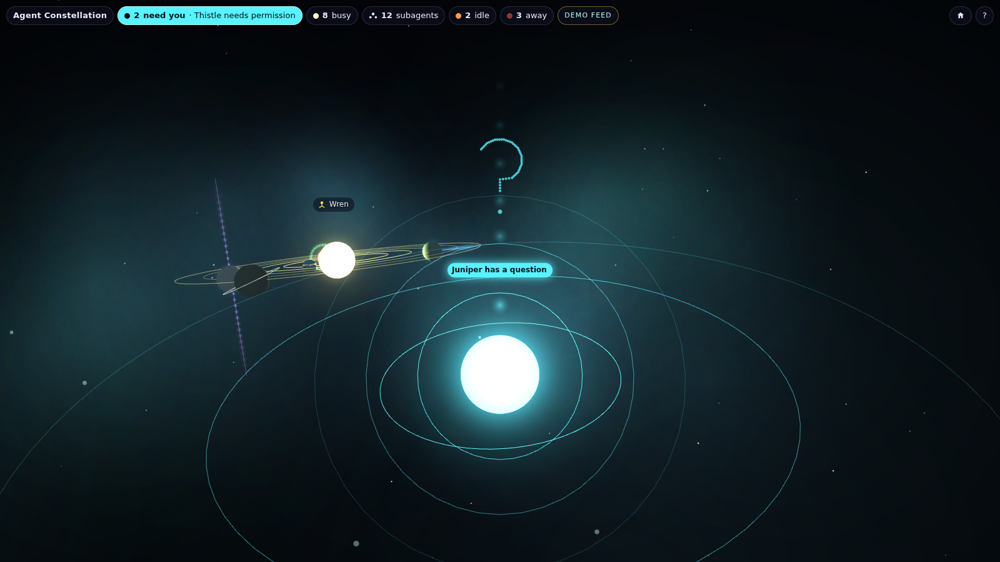
*Waiting on a question: Juniper gets a "?" instead of the padlock, drawn on
top of everything so it shows from any angle; the label says "has a
question".*

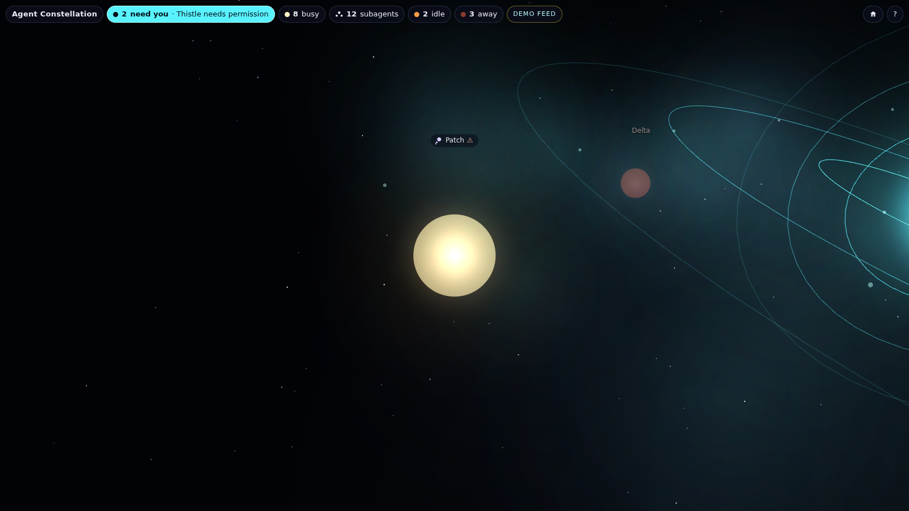
*Stalled: Patch has been busy with nothing written for over five minutes, so
it flickers like a failing bulb and its label shows a
warning sign.*

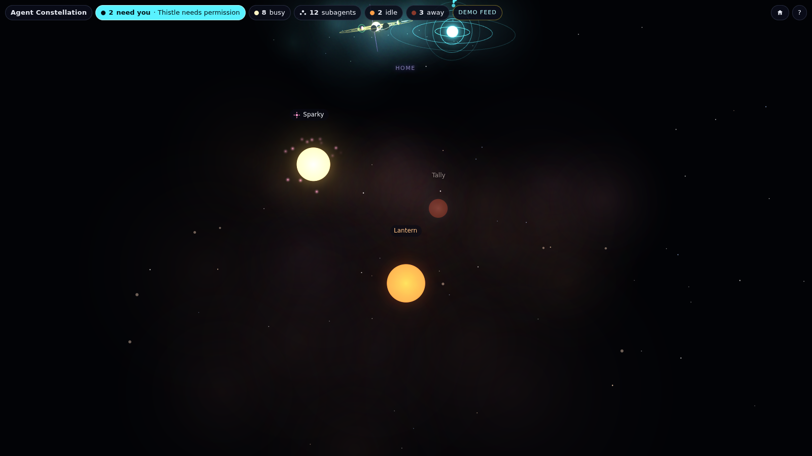
*Idle, offline and other: Lantern glows a dim orange; Tally is a faded ember;
Sparky is busy with an MCP or Skill call (`other`), a shimmer of pink
sparkles.*

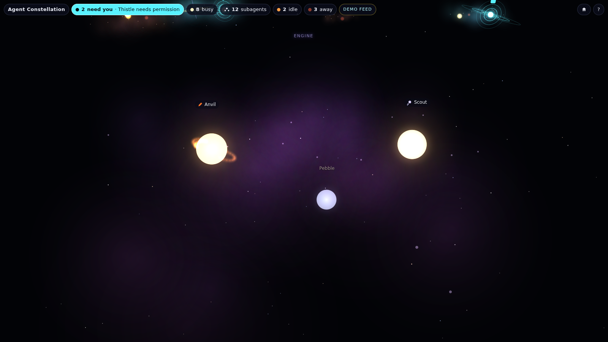
*Anvil is editing (orange flares); Scout is thinking (a soft lavender glow,
the quietest action); Pebble is a shell (`dim`), small and grey-blue.*

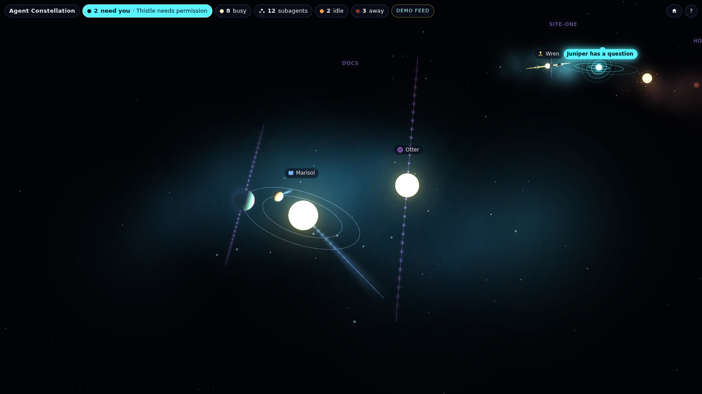
*Reading and on the web: Marisol sweeps a blue beam like a lighthouse, and its
two subagents read and surf too; Otter streams violet jets out of both poles.*

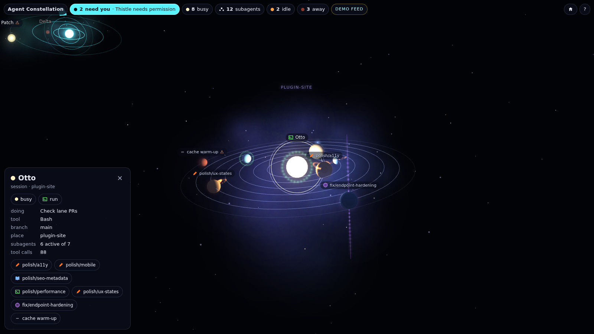
*Tap Otto: the card shows state, action, what it is doing, branch, place,
tool calls and each subagent as a chip you can tap to jump to it. The
selected star gets a white ring and its planets get labels.*

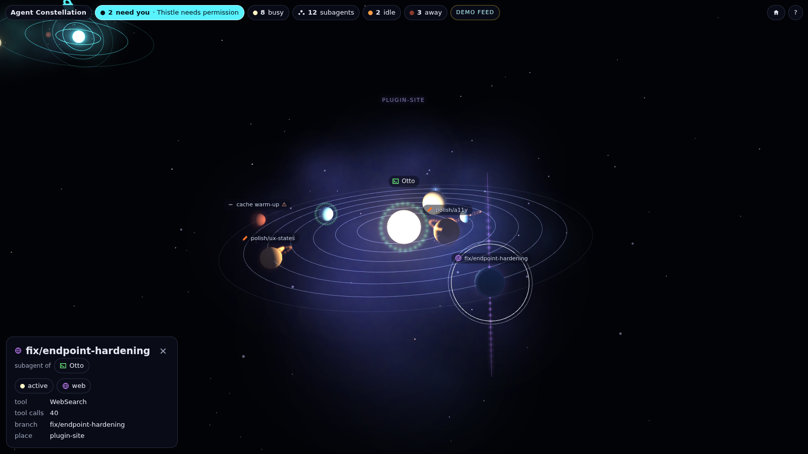
*Tap a planet: "fix/endpoint-hardening" works on its own branch, and its card
says so, with its tool, tool calls and a chip back to Otto.*

<p>

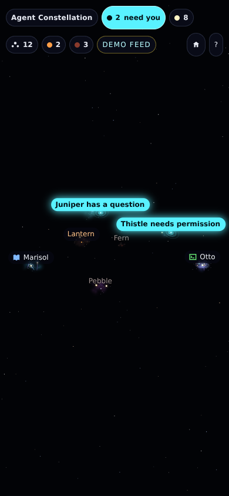
</p>

*On a phone (390 x 844, DPR 3): the bottom sheet for Otto, with the map shrunk
to the space above it; and the whole map, which is wider than it is deep.*


*From above: the places on a golden-angle spiral, each session's system inside
its nebula.*

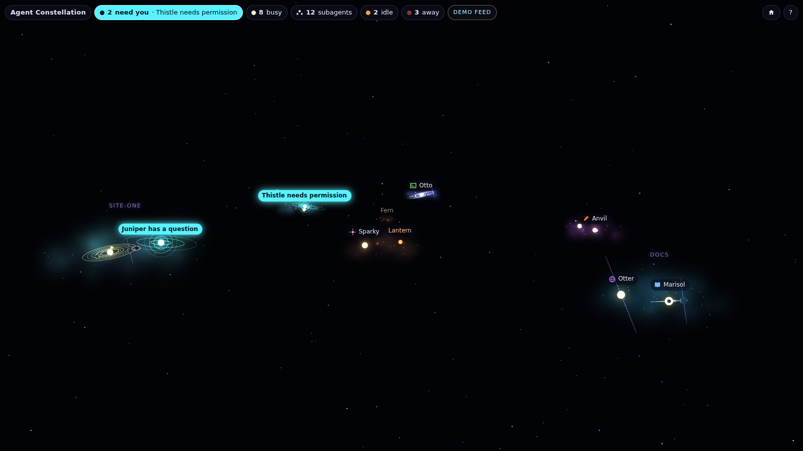
*From a low angle: the tilted orbit planes and the jets standing off them.*

`docs/media/screenshot.png` is the smoke test's frame.

## Build and test

```bash
python3 -m unittest discover -s tests       # serves the fixture; page, assets, feed, vendored PINs, hygiene
npm ci && npx playwright install chromium   # Playwright 1.61.1, for the browser tests
pip install -r requirements-dev.txt         # Pillow, for the GIF
npm run smoke                               # headless Chromium on the demo feed; saves docs/media/screenshot.png
npm run screenshots                         # every image above (or some: npm run screenshots -- hero motion)
EMSDK=/path/to/emsdk vendor/agentviz-kit/scene/build-scene.sh scene/kit.conf   # rebuild web/constellation-engine.*
```

The built engine files are committed, so serving needs only Python. The
browser tests use port 9120 (`CONSTELLATION_TEST_PORT` overrides), the unit
tests 9121 (`CONSTELLATION_UNIT_PORT`). The smoke test reads its expected
counts from the feed document and checks: every session is a star and every
subagent a planet; the needs-you chip cycles both waiting sessions; a tap on
a waiting star opens its card, which says why it waits; the stalled subagent's
planet is labelled stalled; a subagent's own branch shows in its card; a new
tool call pulses; an `` label stays text; the empty state and the
unreachable banner show; the frame is not flat; the console is clean.
`vendor/agentfeed/`, `vendor/agentviz-kit/` and `web/agentviz-*` come from
[agentviz](https://github.com/dmccoystephenson/agentviz) (`tools/vendor-kit.sh`);
do not edit them here.

## How it works

The feed client, the HUD (chips, the selected-agent card and bottom sheet,
the banner, the legend toggle), world labels, tap picking and the
page-to-engine data format are the shared agentviz kit (docs/KIT.md in
agentviz). On top of it, `web/constellation-model.js` keys everything by id,
puts places on a golden-angle spiral (a place keeps its slot for the page's
life) and each session's star on a small spiral inside its place, gives each
subagent a stable orbit slot, and eases everything between snapshots. Each
frame `web/constellation-frame.js` packs nebulae (zones), stars and planets
(agents) in the agentviz wire format; `scene/main.cpp` decodes it with
`agentviz.h` and draws it with Strata's points, lines, spheres and point
lights (`sky.h`, `star.h`, `planet.h`, `actions.h`).

## Gaps and ideas

- Places get a slot the first time they appear and keep it for the page's
  life; a long-lived page with many places that come and go leaves holes.
- On a phone the whole map is small: it is wider than it is deep. Tap a star
  to fly in.
- Ideas: a time-lapse of the last hour, comet trails for subagents that just
  finished, constellation lines between sessions on the same branch.

## Licence

Code: [MIT](LICENSE). Screenshots and GIFs in `docs/media/`:
[CC0 1.0](LICENSE-media). The committed engine bundles Strata (MIT) and its
libraries, and the Emscripten runtime: see
[THIRD_PARTY_NOTICES.md](THIRD_PARTY_NOTICES.md).
