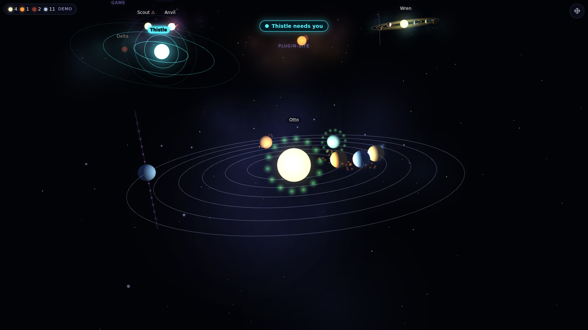
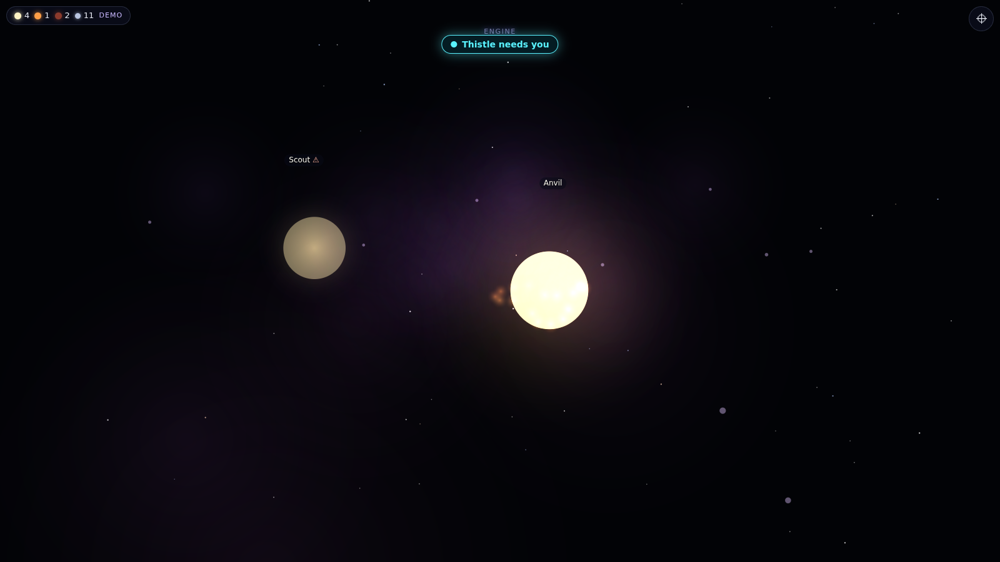
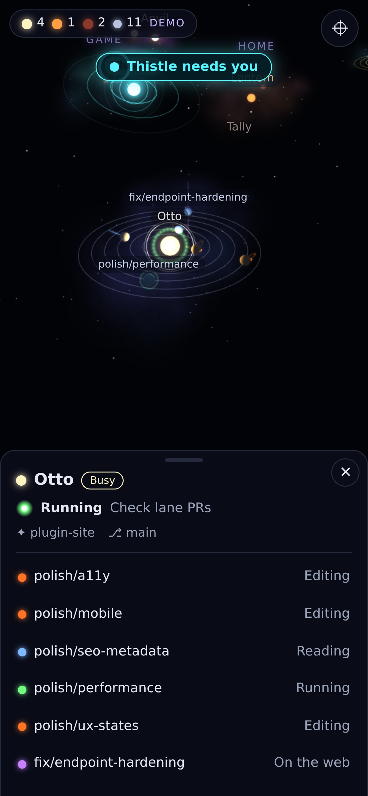
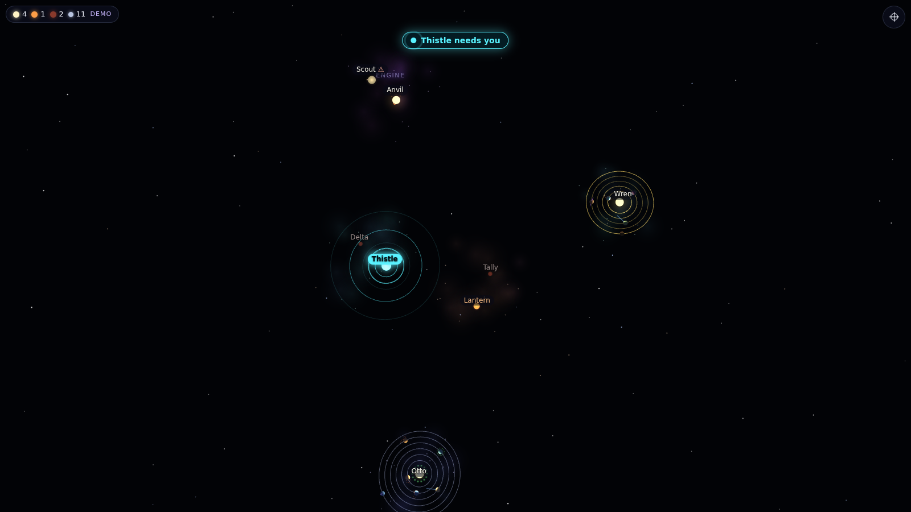

# agentviz-constellation

Claude Code sessions as a star map, drawn with the
[Strata](https://github.com/Preponderous-Software/strata) 0.10.0 web kit. One of
the ten [agentviz](https://github.com/dmccoystephenson/agentviz) visualizations;
it reads only the shared agent feed (`/api/agents`).

Every repo the sessions work in is a faint nebula. Every session is a star,
coloured by its state. Its subagents are planets on visible orbit rings: they
orbit fast while working and drift slowly while resting, and they grow with
their tool calls. What a star is doing right now is drawn on it. A session
that needs you pulses with cyan beacon rings you can't miss.


*The whole map (demo feed). Otto (bottom) and Wren (right) are leads with
subagent planets; Thistle (centre, cyan rings and the top chip) needs the
owner; Lantern is idle (orange); Delta and Tally are offline embers.*

## What you're looking at

| Thing | Means |
|---|---|
| Faint coloured cloud with an uppercase label | a **place**: the repo (working directory) the sessions are in |
| Star | a **session** |
| Planet on an orbit ring round a star | a **subagent** of that session |
| Planet speed | activity: fast = active (wrote < 2 min ago), slow and darker = resting |
| Planet size | grows with the subagent's tool calls |
| Coloured haze round a planet | the subagent's current action (colours as below) |

**States (the star's colour)**

| State | Star |
|---|---|
| busy | bright yellow-white with a warm halo |
| idle | dim orange |
| waiting (needs you) | cyan-white star that **pulses**, cyan **beacon rings expanding outward** across its system, a light column, a marker that shows through everything, and a "*name* needs you" chip at the top (tap it to fly there) |
| offline | small, faded red dwarf / grey ember |
| dim (shell or unknown) | small grey-blue |
| stalled (busy, silent > 5 min) | the star **flickers** like a failing bulb, and its label gets a warning sign |

**Actions (drawn on the star, and in miniature on planets)**

| Action | Effect | Colour |
|---|---|---|
| edit | **flares** that leap off the surface and fall back | orange |
| run | a **pulsing corona** ring | green |
| read | a slow **beam sweeping** round, like a lighthouse | blue |
| web | **jets** streaming out of both poles to the edge of the system | violet |
| delegate | its **orbits brighten** to pulsing gold | gold |
| think | a **steady**, slowly breathing glow | lavender |
| other (MCP, Skill, ...) | a **shimmer** of sparkles | pink |

Tap or click a star or planet to select it: the camera flies to it and a panel
(a bottom sheet on phones) shows its name, state, action and label, place,
branch and subagents (tap one to jump to it). The crosshair button frames the
whole map again. Drag to orbit, pinch or scroll to zoom.

## Screenshots

All from the demo feed (`--fixture`); never a live feed.


*A lead and its subagents: Otto is running a command (green pulsing corona);
its six planets are editing (orange flares), reading (blue beam) and on the web
(violet jet), each on its own ring.*


*Wren is delegating, so its orbits glow gold; its outermost planet
("tests + docs") is resting: darker, no haze, barely moving.*


*Waiting on the owner: Thistle pulses cyan and beacon rings sweep outward, in
its orbit plane and facing the camera.*


*Idle and offline: Lantern glows a dim orange; Tally is a faded ember.*


*Anvil is editing (flares). Scout is thinking (lavender glow) but has been
silent for over five minutes, so it is stalled: it flickers and its label shows
a warning sign.*


*The selected-agent panel (desktop): state, action, place, branch and the
subagents, each with its action colour.*

<p>


</p>

*On a phone (390 x 844, DPR 3): the bottom sheet for Otto, with the map shrunk
to the space above it; and the whole map.*


*From above: the places on a golden-angle spiral, each session's system inside
its nebula.*


*From a low angle: the tilted orbit planes and the jets standing off them.*


*Five seconds of Otto's system: planets orbiting, flares, the pulsing corona,
the sweeping beam and the jet streaming out.*

`docs/media/screenshot.png` is the smoke test's frame.

## Run

```bash
python3 -m vendor.agentfeed serve --web web --port 8847             # live sessions
python3 -m vendor.agentfeed serve --web web --port 8847 --fixture   # demo feed
```

Open <http://127.0.0.1:8847/> (or `/?fixture=1` for the demo feed on a live
server; `?fps=1` shows the kit's frame stats). The page polls `/api/agents`
every 2 s, keys everything by id and eases between snapshots.

## Build

The built scene (`web/constellation-engine.{js,wasm}`) and the kit's page
scripts are committed, so serving needs only Python. To rebuild after editing
`scene/main.cpp` (needs emsdk 6.0.11 at `/root/emsdk` or on `PATH`; downloads
the pinned Strata 0.10.0 tarball into the gitignored `.strata/`):

```bash
scene/build.sh
```

`web/constellation.js` owns the layout, easing and picking, and hands the scene
rows of floats each frame (places, stars, planets); `scene/main.cpp` only draws
them.

## Test

```bash
python3 -m unittest discover -s tests                                   # page, assets, feed
NODE_PATH=/path/to/node_modules node tests/smoke.cjs                    # headless Chromium smoke
NODE_PATH=/path/to/node_modules node tests/screenshots.cjs              # regenerate docs/media/
```

The browser scripts serve the fixture on port 8947 themselves and need
Playwright (chromium, SwiftShader); the GIF is assembled with Pillow. The smoke
test checks the frame is drawn, all eight demo stars are there, the waiting
chip is up, a tap on the waiting star opens its panel, and the console is clean.

## Gaps and ideas

- The demo feed has no session-level `read`, `web` or `other`, so those star
  effects show only on planets in the screenshots.
- Places get a slot the first time they appear and keep it for the page's
  life; a long-lived page with many places that come and go leaves holes.
- Ideas: a time-lapse of the last hour, comet trails for subagents that just
  finished, constellation lines between sessions on the same branch.
